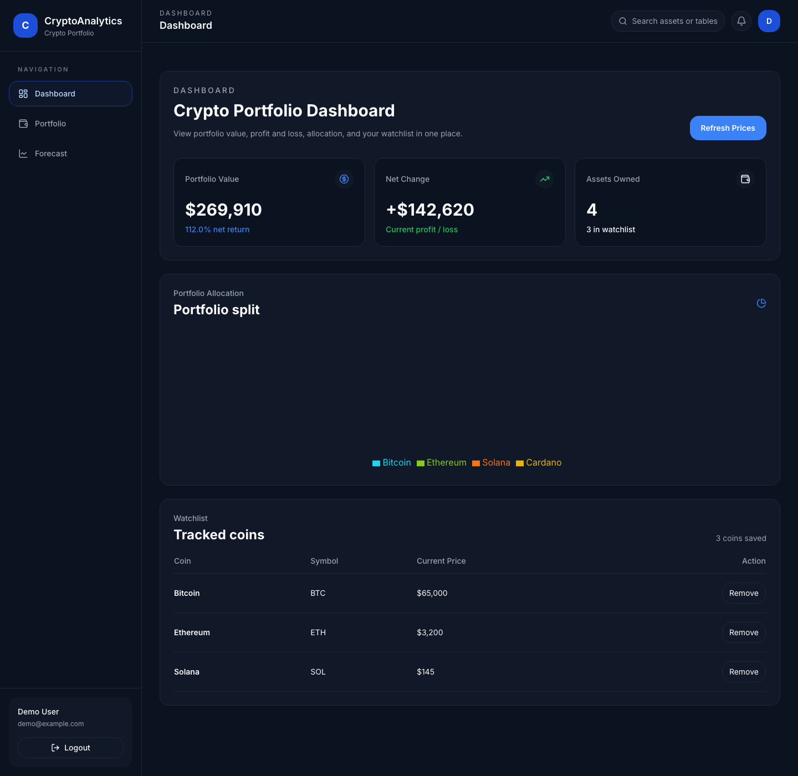
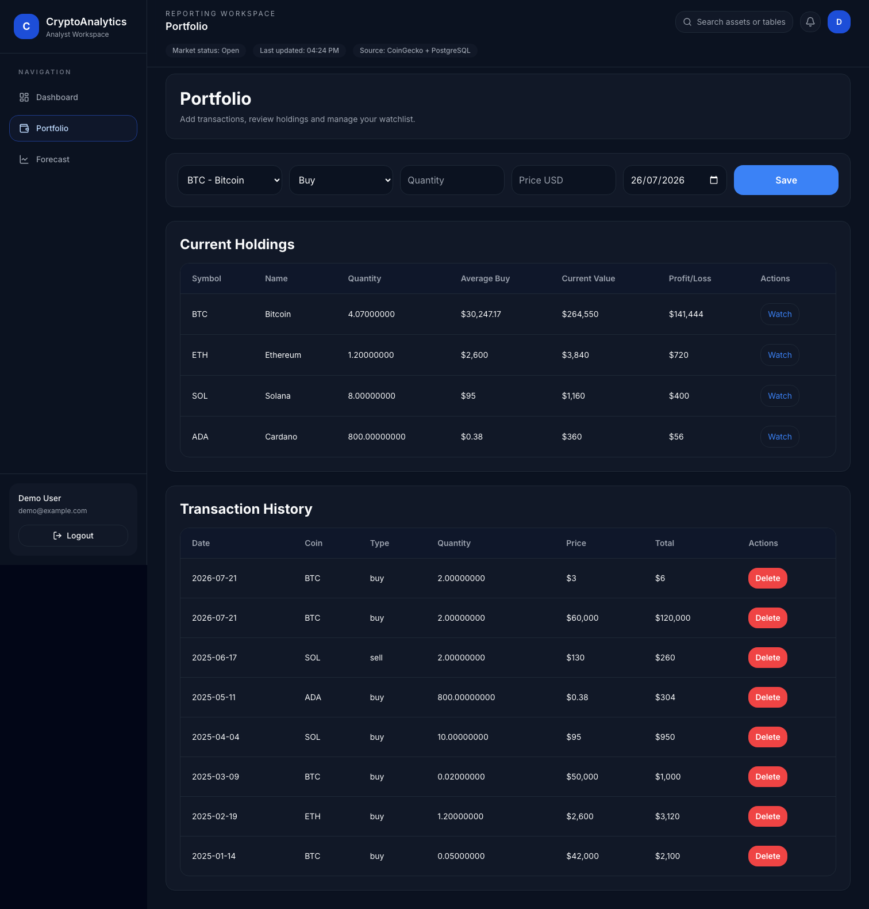

# Crypto Analytics

A full-stack cryptocurrency portfolio tracker and research workspace. The application combines a React portfolio UI, an Express API, PostgreSQL storage, and a Python analytics layer for market-data ingestion, risk analysis, and honest forecasting evaluation.

## Highlights

- Secure registration and login with hashed passwords and JWT-protected API routes.
- Buy/sell transaction ledger, portfolio holdings, allocation, profit/loss, and watchlist management.
- Coin price refreshes from CoinGecko and historical price-based forecasting.
- Analytics for 12 cryptoassets: OHLCV ingestion, data-quality checks, SQL analytical views, risk metrics, portfolio accounting, and model evaluation.
- A Streamlit research dashboard embedded in the React app’s **Analytics** route.
- Automated backend, analytics, and SQL integration tests.

## Screens

| Login | Portfolio dashboard |
| --- | --- |
|  |  |

| Portfolio | Forecast |
| --- | --- |
|  |  |

## Architecture

```text
React + Vite UI ──JWT──> Express API ──> PostgreSQL
      │                       │              │
      │                       └─> Python forecast script
      │
      └─> /analytics embeds Streamlit research dashboard
                                  │
                     Python ETL / metrics / forecasting
                                  │
                         OHLCV, sentiment, SQL views
```

## Technology

| Area | Tools |
| --- | --- |
| Frontend | React, Vite, React Router, Axios, Recharts, Tailwind CSS |
| API | Node.js, Express, PostgreSQL `pg`, JWT, bcrypt |
| Analytics | Python, pandas, NumPy, SciPy, scikit-learn, statsmodels, ARCH, Streamlit, Plotly |
| Database | PostgreSQL, raw SQL, window functions, Docker Compose |
| Testing | Vitest/Supertest, pytest, GitHub Actions |

## Features

### Portfolio application

- Register and sign in; protected routes retain the current user session in local storage.
- Record buy and sell transactions; holdings and average cost are recalculated from the ledger.
- View portfolio value, P&L, allocation, and saved watchlist assets.
- Refresh latest asset prices from CoinGecko.
- View historical prices and linear-regression forecast projections.

### Analytics workspace

- Load daily OHLCV data for BTC, ETH, SOL, ADA, BNB, XRP, DOGE, AVAX, DOT, LINK, LTC, and TRX from Binance.
- Load the Fear & Greed Index, validate price data, and create a data-quality report.
- Query daily returns, rolling averages/volatility, drawdown, momentum ranks, weekday effects, sentiment joins, and reconstructed portfolio values through SQL views.
- Calculate Sharpe, Sortino, Calmar, VaR, CVaR, beta, correlation, efficient-frontier weights, risk contributions, XIRR, and FIFO realised P&L.
- Compare naive, drift, moving-average, linear trend, ARIMA, and gradient-boosting forecasts with walk-forward validation; evaluate volatility forecasts and prediction intervals.
- Use the **Analytics** item in the main navigation to open the embedded Streamlit dashboard.

## Prerequisites

- Node.js 20+ and npm
- Python 3.11+
- PostgreSQL 16+ **or** Docker Desktop with Docker Compose

## Quick start with Docker

This is the fastest way to run a clean local database. Docker loads the base schema, analytics schema, sample data, and views automatically on the first start.

```bash
git clone https://github.com/kritii10/CryptoAnalytics.git
cd CryptoAnalytics

docker compose up -d

export DB_HOST=localhost
export DB_PORT=5432
export DB_NAME=crypto_analytics
export DB_USER=crypto
export DB_PASSWORD=crypto
export JWT_SECRET=replace-with-a-long-random-value

npm ci
python3 -m venv .venv
.venv/bin/python -m pip install -r analytics/requirements.txt

# Fetch real market data. Re-runnable; it upserts rows instead of duplicating them.
.venv/bin/python -m analytics.etl.ingest

# Build and run the React application and Express API together.
npm run build
PORT=5050 npm start
```

Open [http://localhost:5050](http://localhost:5050). In a second terminal, run the analytics dashboard:

```bash
cd CryptoAnalytics
export DB_HOST=localhost DB_PORT=5432 DB_NAME=crypto_analytics DB_USER=crypto DB_PASSWORD=crypto
.venv/bin/streamlit run analytics/dashboard.py
```

The dashboard runs at [http://localhost:8501](http://localhost:8501) and is also available in the app at `/analytics`. Set `VITE_ANALYTICS_URL` before building if Streamlit is hosted somewhere other than `http://localhost:8501`.

## Local PostgreSQL setup

If PostgreSQL is already installed locally, create the database and apply the scripts in this order:

```bash
createdb crypto_analytics
psql -d crypto_analytics -f database/schema.sql
psql -d crypto_analytics -f database/analytics_schema.sql
psql -d crypto_analytics -f database/sample_data.sql
psql -d crypto_analytics -f database/analytics_views.sql
```

Then use the same environment variables and application commands from the Docker setup above. The default database name is `crypto_analytics`; `DB_CONNECT_TIMEOUT` and `DB_CONNECT_TIMEOUT_MS` can be used to change the Python and Node connection timeouts.

## Demo account

After loading `database/sample_data.sql`, sign in with:

```text
Email:    demo@example.com
Password: password123
```

Use this only for local development. Change credentials and `JWT_SECRET` in any shared or deployed environment.

## Commands

| Command | Purpose |
| --- | --- |
| `npm run frontend` | Run Vite’s development server on port 5173; set `VITE_API_URL=http://localhost:5050/api` automatically. |
| `npm run backend` | Run the API on port 5050. |
| `npm run build` | Create the production React bundle in `frontend/dist`. |
| `npm start` | Run Express and serve the production frontend bundle. |
| `npm test` | Run the API integration suite. A populated database is required. |
| `.venv/bin/python -m analytics.etl.ingest` | Fetch and upsert live market data. |
| `.venv/bin/python -m analytics.forecasting --symbol BTC --horizon 7` | Run price-model evaluation and save a report. |
| `.venv/bin/streamlit run analytics/dashboard.py` | Launch the analytics dashboard. |
| `.venv/bin/python -m pytest analytics/tests -q` | Run analytics and SQL integration tests. |

## Data sources and safety

- **Binance public API:** daily USDT OHLCV candles; USDT is used as a USD proxy.
- **Alternative.me:** Fear & Greed Index.
- **CoinGecko:** current-price refreshes for portfolio assets.
- `python -m analytics.etl.ingest --source synthetic` creates synthetic demo/CI data only. It is explicitly marked `source = 'synthetic'`; do not use it for real investment conclusions.
- Forecasting and risk outputs are research tools, not financial advice. Crypto returns are volatile, models can fail, and historical results do not guarantee future performance.

## Testing

The project includes API tests plus Python unit and database integration tests.

```bash
# Database must be running and contain the schemas/views.
npm test
.venv/bin/python -m pytest analytics/tests -q
```

The GitHub Actions workflow provisions PostgreSQL, loads synthetic data, and runs the analytics suite on changes to analytics/database files.

## Project layout

```text
backend/                 Express API, authentication, transactions, and portfolio routes
frontend/                React application and pages, including the Analytics integration
database/                Base schema, sample data, analytics schema, and SQL views
forecast/                Existing Python linear-regression forecast script
analytics/
  etl/                   Market-data ingestion and validation
  notebooks/             EDA, portfolio/risk, and forecasting notebooks
  tests/                 pytest unit and SQL cross-check tests
  dashboard.py           Streamlit analytics application
  metrics.py             Risk and portfolio-construction metrics
  forecasting.py         Walk-forward price and volatility model evaluation
docs/                    Data dictionary, methodology, and findings
```

## Troubleshooting

| Problem | Resolution |
| --- | --- |
| API reports a database error | Confirm PostgreSQL is running and the `DB_*` variables match it. `docker compose ps` should show a healthy database when using Docker. |
| Analytics dashboard cannot load prices | Run the ETL command after applying the analytics schema. A CSV fallback can be produced with `--export-csv`. |
| `/analytics` is blank | Start Streamlit on port 8501, or rebuild with an appropriate `VITE_ANALYTICS_URL`. |
| API tests hang or fail | Confirm the test database is available and contains `coins` plus `price_history`; connection timeouts are configurable with `DB_CONNECT_TIMEOUT_MS`. |
| Docker database has old schema/data | Stop it and remove only the project’s Docker volume, then run `docker compose up -d` again. |

## Further reading

- [Data dictionary](docs/data_dictionary.md)
- [Methodology and limitations](docs/methodology.md)
- [Findings write-up](docs/findings.md)
